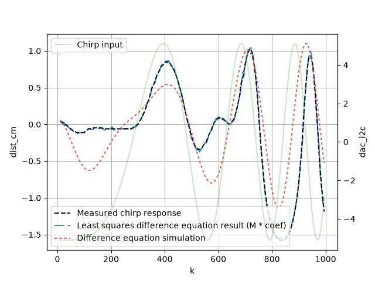

# digital-control

## model_leastsquares.py

Fits a difference equation to CSV data using least squares.

```powershell
.venv\Scripts\Activate.ps1
python model_leastsquares.py --file data/2026-10-07_model_100Hz.csv --order 2 --decimate 5 --u-scale -293 --y-offset 10.25 --end 1000
```




Output:
```bash
Coefficients:
  a1 = -1.92894
  a2 = 0.946607
  b1 = 0.00998879
  b2 = -0.00861729

Poles:
  p1 = 0.964469+0.128088j
  p2 = 0.964469-0.128088j

Zeros:
  z1 = 0.862695
```