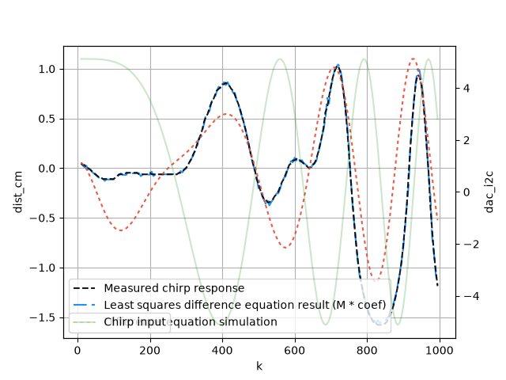
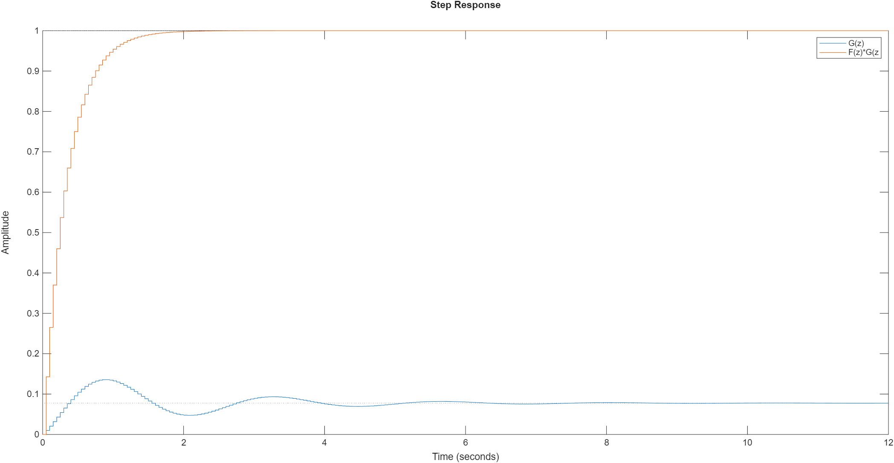
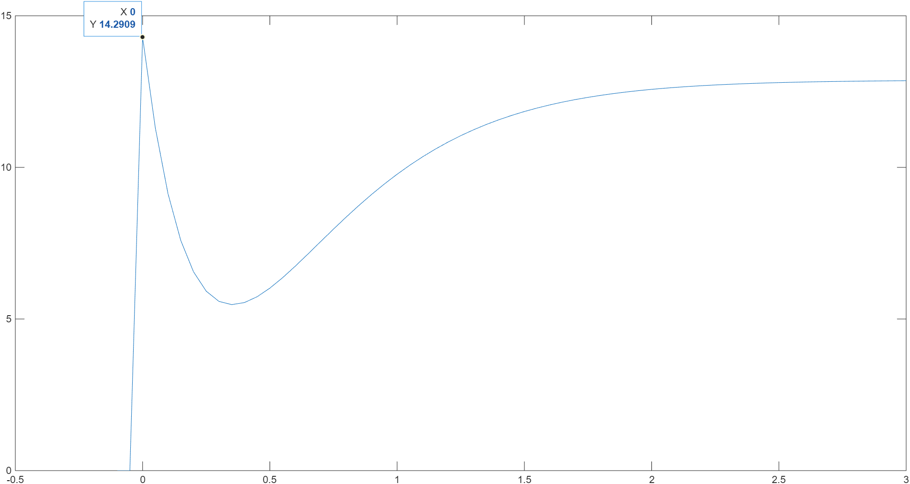
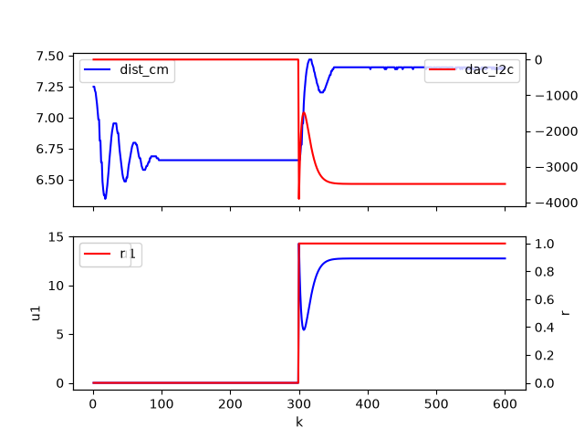
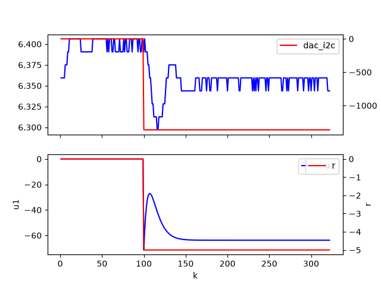
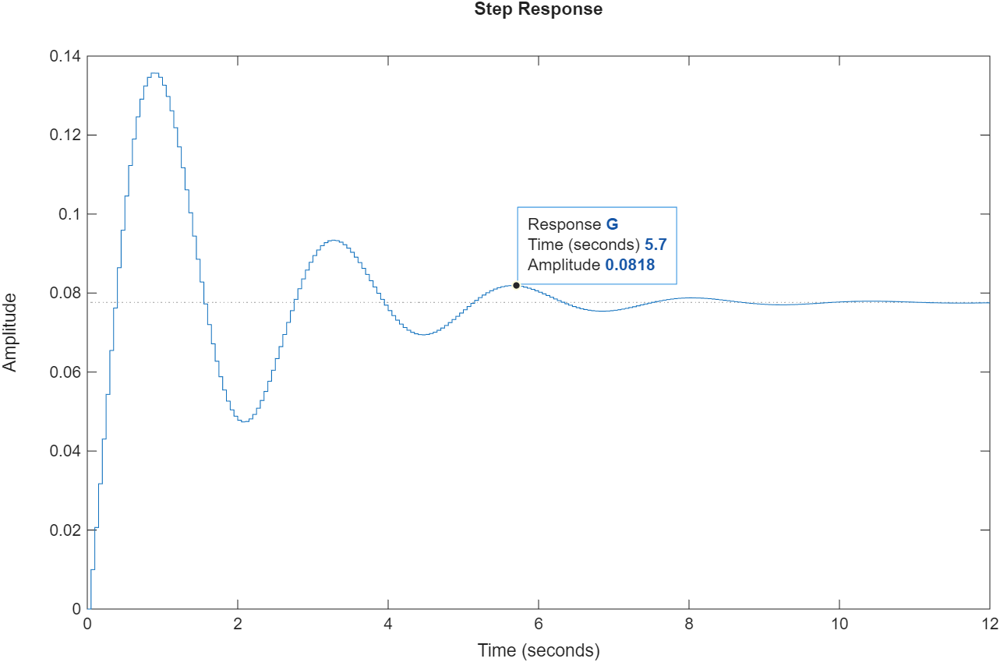
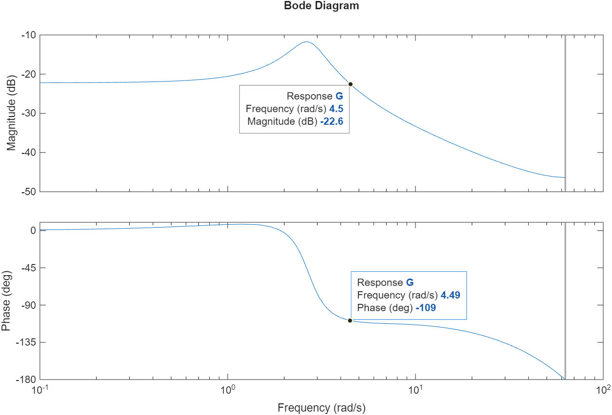
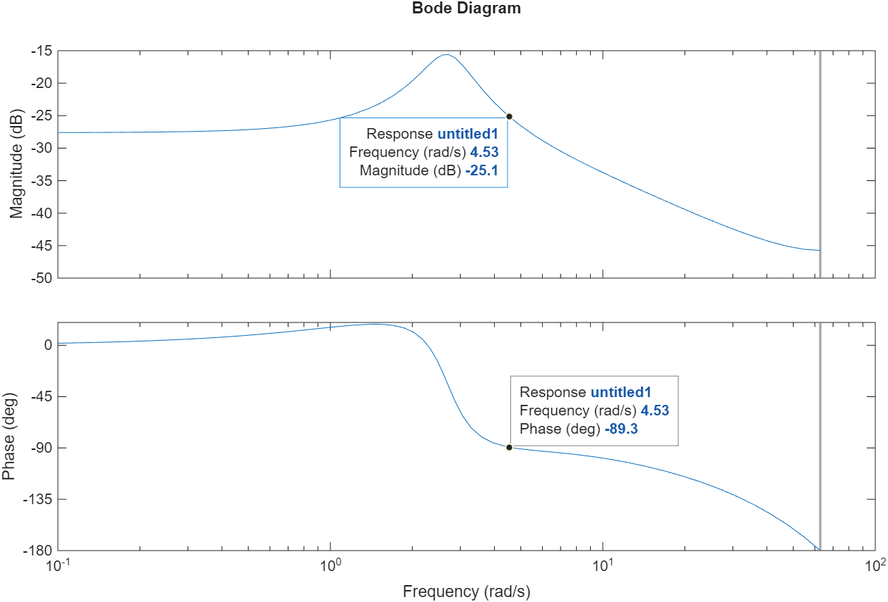

# digital-control

## model_leastsquares.py

Fits a difference equation to CSV data using least squares.

```powershell
.venv\Scripts\Activate.ps1
python model_leastsquares.py --file data/2026-10-07_model_100Hz.csv --order 2 --decimate 5 --u-scale -293 --y-offset 10.25 --end 1000
```




Output:
```bash
Coefficients:
  a1 = -1.92894
  a2 = 0.946607
  b1 = 0.00998879
  b2 = -0.00861729

Poles:
  p1 = 0.964469+0.128088j
  p2 = 0.964469-0.128088j

Zeros:
  z1 = 0.862695
```

## Open-loop control

To design an open-loop controller, F(z) for this system we target DC gain of 1 (cm/V) for F(z)*Gplant(z), and cancellation of the poles at `0.9644 +/- i*0.1281`.

Controller (see hw11_solution.m):

```matlab
F =
 
  14.29 z^2 - 27.57 z + 13.53
  ---------------------------
     z^2 - 1.72 z + 0.7396
 
Sample time: 0.05 seconds
Discrete-time transfer function.
```



Maximum control effort of F(z) is 14.29 V, which is around the achievable limit of the controller output:


Here is the open-loop control step response F(z)*G(z) (open_loop.py):


Axis and signal mapping:
- top left:     $\color{blue}{\textsf{y[k] (cm)}}$
- bottom left:  $\color{red}{\textsf{r[k] [0, 1.0]}}$
- bottom right: $\color{blue}{\textsf{u[k] (V)}}$
- top right:    $\color{red}{\textsf{DAC I2C input [-4096, 4096]}}$

This is significantly better than uncontrolled, open-loop plant step response G(z):


## Closed-loop control

To design a closed-loop controller, F(z) for this system we target 1/5 the settling time to a step response that the uncompensated plant response has:



We need to achieve less than 2% steady state error.

### Lead compensator design

We need a 5% setting time of about 1 second. That means a bandwidth of around 4 rad/s. 



Let's add around 20 degrees of phase lead at 4.5 rad/s for a phase margin of the lead-compensated system of around 90 degrees. Using geometry, this means a zero at around 0.85 and a pole at around 0.72.

Dlead(z)*G(z):


This achieves our phase lead of 20 degrees at 4.5 rad/s.

### Lag compensator design

We need steady state error less than 2%. Let's target 1%.

The DC gain of the closed-loop transfer function is given by:

```matlab
  D(1)*G(1)
-------------
1 + D(1)*G(1)
```

The DC gain of the open-loop transfer function `D(z)*G(z)` must be at least 99 -> ~40 dB.

Use the rule of thumb equation for zero placement (4.5 rad/s * 0.05s -> 12.89 deg):

```matlab
a = 1 - 12.89/500 = 0.97422
```
While this placement minimizes phase lag at the crossover frequency, it creates a slow closed-loop pole near $z = 0.989$ (a "lag tail") that takes over 10 seconds to fully settle. Therefore, a faster zero placement of $0.85$ was chosen.

To calculate the pole location $p$, factoring in the lead gain $K = 18$:
```matlab
99 = D(1)*G(1) = Klead * Dlag(1) * Dlead(1) * G(1)

      1 - 0.85             1 - 0.85      0.00998879 - 0.00861729
99 = ------------- * 18 * ---------- *  -------------------------
      1 - p                1 - 0.72      1 - 1.92894 + 0.946607

p = 0.998866
```

The combined lead-lag compensator $D(z) = 18 \cdot D_{\text{lag}}(z) \cdot D_{\text{lead}}(z)$ is:

```matlab
         18 (z - 0.85)^2            18 z^2 - 30.6 z + 13.005
D(z) = ----------------------- = ------------------------------
       (z - 0.72)(z - 0.9989)       z^2 - 1.7189 z + 0.7192
```

### Hardware Implementation Considerations

1. **Actuator Authority Limits**: The physical coil can only displace the object from $\sim 6.0\text{ cm}$ (resting) to $\sim 7.35\text{ cm}$ (maximum power, $-4095$ DAC counts). Requesting setpoints beyond this range (e.g., $r = 8.0\text{ cm}$) is physically unattainable and causes the controller to permanently peg at $+15\text{ V}$. Setpoints must remain within the achievable linear range (e.g., baseline $r = 6.8\text{ cm}$, stepping to $r = 7.1\text{ cm}$).
2. **Gain Selection ($K = 18$ vs. $K = 40$)**: While $K = 40$ appears faster in an idealized, unconstrained linear simulation, on physical hardware $K = 40$ commands excessive voltages ($40\text{ V/cm}$), immediately saturating the $\pm 15\text{ V}$ DAC and eroding phase margin due to sensor latency ($\sim 35\text{ ms}$). $K = 18$ maintains peak control efforts within $\approx 5\text{ V}$ and delivers stable, non-saturating control.
3. **Anti-Windup Clamping**: Because the lag pole $p \approx 0.9989 \approx 1.0$ acts as an accumulator/integrator, internal states must be clamped to the physical $\pm 15\text{ V}$ actuator limits (`u1 = max(-15.0, min(15.0, u1))`) to prevent integrator runaway during transient saturation.