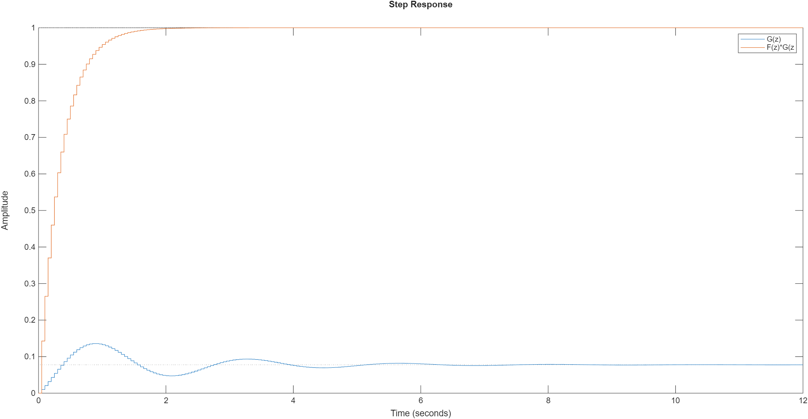
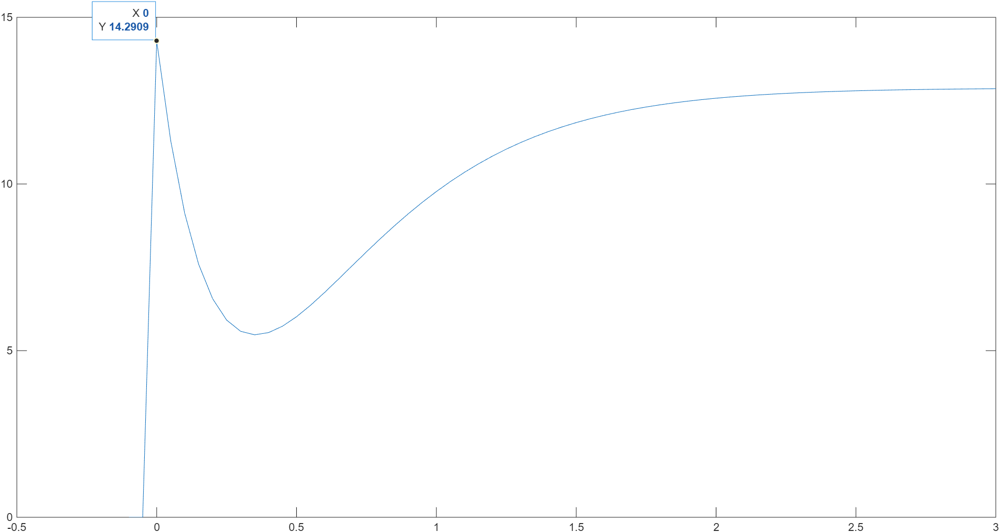
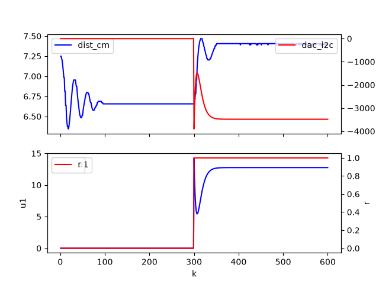
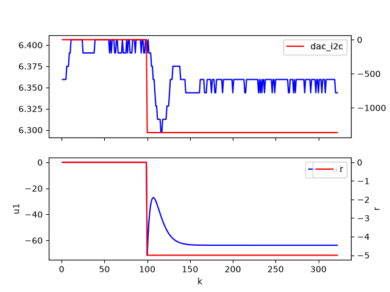

# digital-control

## model_leastsquares.py

Fits a difference equation to CSV data using least squares.

```powershell
.venv\Scripts\Activate.ps1
python model_leastsquares.py --file data/2026-10-07_model_100Hz.csv --order 2 --decimate 5 --u-scale -293 --y-offset 10.25 --end 1000
```


Output:
```bash
Coefficients:
  a1 = -1.92894
  a2 = 0.946607
  b1 = 0.00998879
  b2 = -0.00861729

Poles:
  p1 = 0.964469+0.128088j
  p2 = 0.964469-0.128088j

Zeros:
  z1 = 0.862695
```

## Open-loop control

To design an open-loop controller, F(z) for this system we target DC gain of 1 (cm/V) for F(z)*Gplant(z), and cancellation of the poles at `0.9644 +/- i*0.1281`.

Controller (see hw11_solution.m):

```matlab
F =
 
  14.29 z^2 - 27.57 z + 13.53
  ---------------------------
     z^2 - 1.72 z + 0.7396
 
Sample time: 0.05 seconds
Discrete-time transfer function.
```



Maximum control effort of F(z) is 14.29 V, which is around the achievable limit of the controller output:


Here is the open-loop control step response F(z)*G(z) (open_loop.py):


Axis and signal mapping:
- top left:     $\color{blue}{\textsf{y[k] (cm)}}$
- bottom left:  $\color{red}{\textsf{r[k] [0, 1.0]}}$
- bottom right: $\color{blue}{\textsf{u[k] (V)}}$
- top right:    $\color{red}{\textsf{DAC I2C input [-4096, 4096]}}$

This is significantly better than uncontrolled, open-loop plant step response G(z):


## Closed-loop control

To design a closed-loop controller, F(z) for this system we target DC gain of 1 (cm/V) for F(z)*Gplant(z), and cancellation of the poles at `0.9644 +/- i*0.1281`.

Controller (see hw11_solution.m):

```matlab
F =
 
  14.29 z^2 - 27.57 z + 13.53
  ---------------------------
     z^2 - 1.72 z + 0.7396
 
Sample time: 0.05 seconds
Discrete-time transfer function.
```
